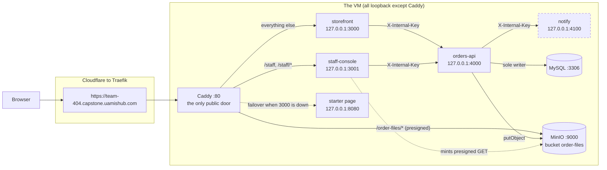
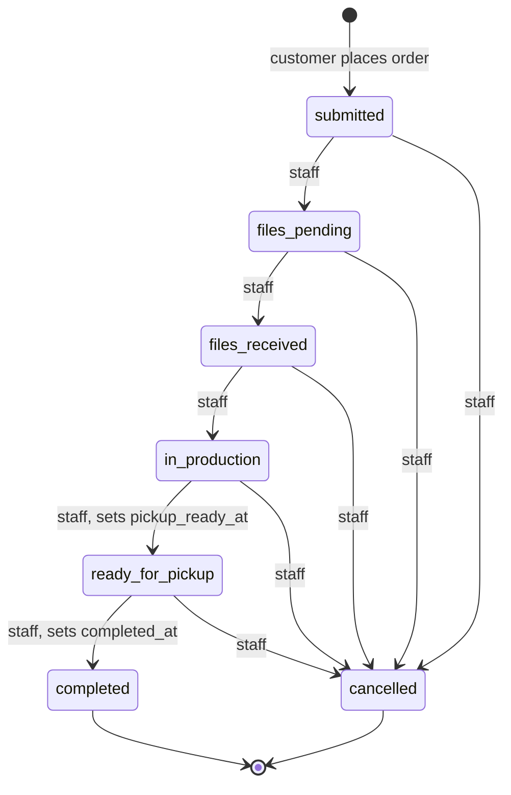
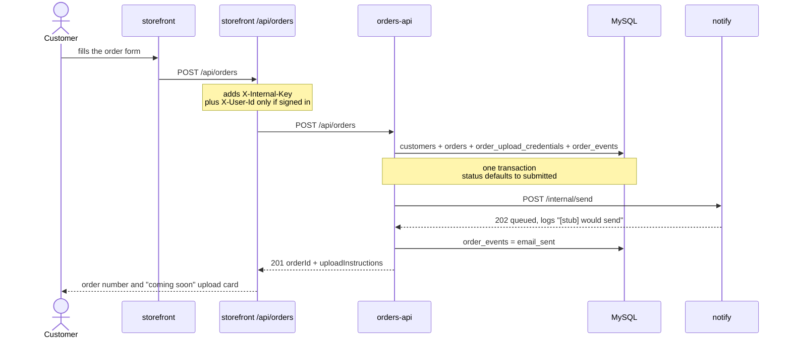
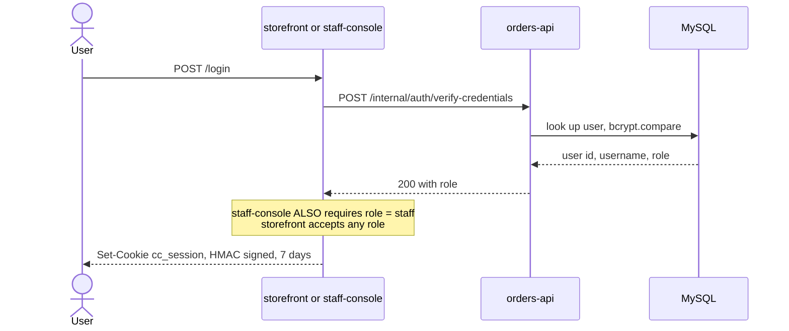
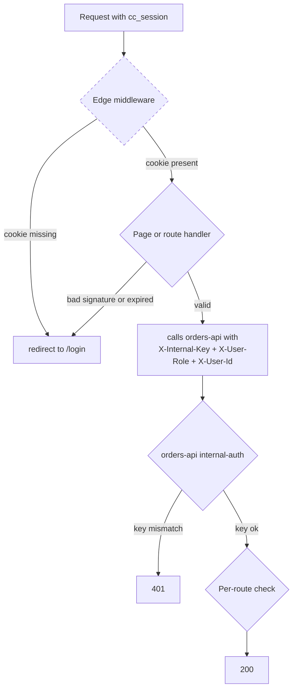
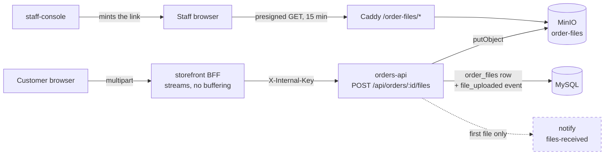

# Architecture

How the Crimson Copies application actually works: which service calls which, where an
order's state changes, what guards what, and what touches the database and object storage.

The README covers the *machine* — services, ports, deploying, logs. This covers the *app*.

> Every arrow below was derived from a specific call site, listed in
> [Where these came from](#where-these-came-from). Where the code and the running VM
> disagree, the running VM wins and the difference is called out. Anything not verified
> is labelled **unverified**.

---

## 1. Services, and how traffic reaches them

Four services run on one VM. Only Caddy on `:80` is reachable from outside; everything
else binds to loopback.

**staff-console is served under the `/staff` path prefix** on the team's single public
hostname (`https://team-404.capstone.uamishub.com/staff`). It is *not* a `staff.`
subdomain: the free-plan wildcard certificate covers only one label, so
`staff.team-404.capstone.uamishub.com` can never get a certificate (platform decision
D-044/ADR-028). Caddy matches `path /staff /staff/*` and forwards to `127.0.0.1:3001`
unchanged; the app sets `basePath: '/staff'` (`apps/staff-console/next.config.ts`) so
every route, asset and redirect it emits already carries the prefix and nothing
collides with the storefront at `/`. The seeded `staff` account signs in at
`/staff/login`.

> **Deploy note.** The route lives in `deploy/vm/Caddyfile`. `capstone-app-deploy`
> rebuilds the app but does **not** install the Caddyfile — a freshly provisioned VM
> still loads the cloud-init copy (`.devops/chart/base/cloud-init.yaml` →
> `/etc/caddy/Caddyfile`), which matches staff-console on the dead `staff.` host. Until
> cloud-init is updated, `deploy/vm/Caddyfile` must be installed by hand — see
> `docs/manual-deploy.md` ("Reverse proxy").

**notify sends no email.** Its handler logs `[stub] would send …` and returns 202. There
is no SMTP configuration anywhere and no mail dependency. It is drawn dashed for that
reason.

---

## 2. The order lifecycle

Every transition is enforced against a fixed graph; an illegal jump is rejected with
`400 invalid_transition`.

A customer can only *create* an order. **Every other transition is staff-only**, and the
only way to make one is `PATCH /api/orders/:id/status`, which requires `X-User-Role:
staff`. `completed` and `cancelled` are terminal.

There is one non-staff path in the code: registering an uploaded file flips
`files_pending → files_received` automatically. **Nothing calls it today** — see
[section 5](#5-file-handling).

---

## 3. Placing an order

The browser never talks to `orders-api` and never sees `INTERNAL_API_KEY`. The
storefront's own `/api/orders` route is a backend-for-frontend that adds the key
server-side.

Signing in is optional — a guest order gets a `customers` row with `user_id` left null.
Price is computed from a static table at creation, except `department_job`, which staff
quote by hand.

Two things worth knowing:

- **`order_events` records `email_sent` for an email that was never sent.** notify returns
  202 without delivering, and the caller treats any 2xx as success. Do not read that row
  as evidence a customer was contacted.
- A notify failure never fails the order — it is recorded as `email_send_failed` and the
  order is still created.

---

## 4. Authentication

There are two independent session systems and one service-to-service secret. **There is
no JWT here** — the session cookie is a base64url payload with an HMAC-SHA256 signature,
and passwords are hashed with bcrypt.

Each request then passes three checkpoints:

- **The middleware is not a security boundary.** It only checks that the cookie *exists*
  — it never verifies the signature. It is a redirect for convenience; the code says so.
- **The real check** is `getSession()` / `getStaffSession()` in each page and route
  handler, which verifies the HMAC and the 7-day expiry. `getStaffSession()` additionally
  requires `role === 'staff'`.
- **The two apps do not share sessions.** Each signs with its own `SESSION_SECRET`, so a
  storefront cookie is not valid on staff-console.
- **`orders-api` never verifies a session.** It trusts `X-User-Role` / `X-User-Id`
  *because* it is bound to loopback and the browser cannot reach it. That is the whole
  basis of the trust — if `orders-api` were ever exposed, anyone could set those headers.

Per-route checks inside `orders-api`:

| Route | Rule |
|---|---|
| `PATCH /api/orders/:id/status` | `role` must be `staff`, else 403 |
| `GET /api/orders` (no `mine`) | `role` must be `staff`, else 403 |
| `GET /api/orders?mine=true` | customer only; anyone else gets an empty list |
| `GET /api/orders/:id` and `/files` | a customer may only read their own order |

Note the last row: the ownership check applies **only when the caller is a customer**. A
request with no session is treated as a guest, not as a customer, so the order-status page
is readable by direct link without signing in. That is deliberate — it is the guest
checkout flow — but it does mean order ids are guessable.

> **Known gap, verified on the live VM (2026-09-01).** Visiting `/orders` while signed out
> returns `307` to `http://localhost:3000/login?next=%2Forders` instead of a path on the
> real hostname, so the redirect lands nowhere in a real browser. Reproduced on all three
> team VMs. The cause is the proxy hop between Caddy and Next.js not carrying the external
> host; the precise fix is **unverified** and is left as work to do.

---

## 5. File handling

Customers upload their print files from the browser. orders-api is the only writer to MinIO,
the same way it is the only writer to MySQL; staff-console reads with its own scoped,
read-only credentials and never proxies the bytes.

How it holds together:

- **The object is written before the row.** If the stream is truncated by the 50MB limit, or
  the insert fails, the object is deleted again — so no `order_files` row ever points at bytes
  that aren't there.
- **Object keys are `<order_id>/<uuid>-<sanitised filename>`.** The UUID keeps two customers'
  `resume.pdf` apart and makes the key unguessable; the original name is kept in MySQL for
  staff to read.
- **Uploads are checked against an extension allowlist** (documents and images) and capped at
  50MB, enforced on the incoming stream rather than after buffering.
- **The first file advances the order to `files_received`** and triggers the one notify call.
  Subsequent files are recorded without repeating it.
- **Downloads are presigned, not proxied.** staff-console signs a 15-minute GET against the
  *public* hostname, because SigV4 covers the `Host` header — a link signed for `127.0.0.1`
  cannot be rewritten afterwards. Caddy forwards `/order-files/*` to MinIO unchanged. The
  bucket has no anonymous read policy, so an unsigned or tampered URL gets a 403 from MinIO.

Still unfinished here:

- `services/file-intake`, the SFTP server referenced in comments and shared schemas, **does
  not exist**; nothing listens on port 2222. orders-api still mints a one-time SFTP credential
  per order and returns it once, and nothing consumes it. `order_files.uploaded_via` keeps the
  `'sftp'` value for the rows that service would have written.
- `POST /internal/orders/:id/files` (the registration endpoint that SFTP path would call)
  still has no caller.

---

## Where these came from

Each diagram, and the file and function each claim was read from.

| Diagram | Derived from |
|---|---|
| 1. Topology | `apps/storefront/src/lib/internal-api.ts` → `callOrdersApi()`; `apps/staff-console/src/lib/internal-api.ts` → `callOrdersApi()`; `apps/orders-api/src/lib/notify-client.ts` → `sendNotification()`; `apps/staff-console/src/lib/minio.ts` → `presignFileUrl()`; bind addresses from `apps/orders-api/src/config.ts`, `services/notify/src/config.ts`, and `PORT`/`HOSTNAME` in `deploy/vm/systemd/cc-*.service` |
| 1. Public reachability | `deploy/vm/Caddyfile` — `@staff path /staff /staff/*` → `reverse_proxy 127.0.0.1:3001`, everything else → storefront. Paired with `basePath: '/staff'` in `apps/staff-console/next.config.ts`. NOTE: a freshly provisioned VM still loads the cloud-init Caddyfile (`/etc/caddy/Caddyfile`), which predates this and matches staff-console on the unreachable `staff.` host — `deploy/vm/Caddyfile` must be installed by hand until cloud-init catches up |
| 2. Order lifecycle | `packages/shared/src/status-transitions.ts` → `ORDER_STATUS_TRANSITIONS`; enforced in `apps/orders-api/src/repositories/orders-repository.ts` → `updateOrderStatus()`; staff-only gate in `apps/orders-api/src/routes/orders.ts` → `PATCH /api/orders/:id/status` |
| 3. Placing an order | `apps/storefront/src/components/OrderForm.tsx` → `handleSubmit()`; `apps/storefront/src/app/api/orders/route.ts` → `POST()`; `apps/orders-api/src/routes/orders.ts` → `POST /api/orders`; `apps/orders-api/src/repositories/orders-repository.ts` → `createOrder()`; `apps/orders-api/src/lib/notify-and-record.ts` → `doNotifyThing()` |
| 3. `email_sent` on a stub | `services/notify/src/routes/send.ts` → `POST /internal/send` returns 202 without sending; `notify-and-record.ts` → `doNotifyThing()` writes `email_sent` on any success |
| 4. Login | `apps/storefront/src/app/login/page.tsx` → `login()`; `apps/staff-console/src/app/login/page.tsx` → `login()` (adds the `role === 'staff'` check); `apps/orders-api/src/routes/internal.ts` → `POST /internal/auth/verify-credentials`; `orders-repository.ts` → `verifyUserCredentials()` |
| 4. Session mechanics | `apps/storefront/src/lib/session.ts` and `apps/staff-console/src/lib/session.ts` → `createSessionCookieValue()`, `verifySessionCookieValue()`, `getSession()`, `getStaffSession()` |
| 4. Middleware is not the boundary | `apps/storefront/src/middleware.ts` and `apps/staff-console/src/middleware.ts` → `middleware()` |
| 4. Internal key | `apps/orders-api/src/plugins/internal-auth.ts` → `createRequireInternalKey()`; `services/notify/src/plugins/internal-auth.ts` → `createRequireInternalKey()` |
| 4. Per-route rules | `apps/orders-api/src/routes/orders.ts` → `isForbiddenForCustomer()` and the `mine` branch of `GET /api/orders` |
| 4. Redirect gap | Observed against all three live VMs; `Location` header read directly from the response |
| 5. File handling | `apps/orders-api/src/routes/orders.ts` → `POST /api/orders/:id/files`; `apps/orders-api/src/lib/storage.ts` → `ensureBucket()`; `orders-repository.ts` → `registerUploadedFile()`; `apps/storefront/src/app/api/orders/[id]/files/route.ts` → `POST()`; `apps/storefront/src/components/OrderFileUpload.tsx`; `apps/staff-console/src/lib/minio.ts` → `presignFileUrl()`; `deploy/vm/Caddyfile` → `@files path /order-files/*` |
| 5. Sole MySQL writer | Only `apps/orders-api/**` imports `drizzle-orm` / `mysql2`; only `apps/staff-console/src/lib/minio.ts` imports `minio` |
